**AI Engineer · Software Architect · Open-source builder**

[LinkedIn](https://www.linkedin.com/in/antonio-antenore-a9b44a107/) · Turin, Italy

AI engineer and software architect in Turin, Italy, building open-source agentic AI systems: multi-agent orchestration, MCP and A2A, local LLM runtimes, knowledge graphs and forecasting.

<h3 align="center">Pitch 1 · Open-source AI agent projects</h3>

When an idea crosses my mind, I build it, mostly to find out where it breaks. Safety goggles not included. 
Each project's README says what is proven and what is still open. 
The pinned repositories are what I would show first; everything else is in the <a href="https://github.com/aantenore?tab=repositories">repositories tab</a>.

Background: full-stack, microservices, distributed systems, data engineering, cloud-native and applied AI, with research in security and privacy for IoT systems. 
Interests: agentic AI · multi-agent systems · MCP and A2A · local AI · distributed inference · forecasting · knowledge graphs · data platforms · event-driven architecture · cloud-native · AWS · Kafka · Python · TypeScript · Java / Spring Boot · React

<h3 align="center">Pitch 2 · Engineering principles</h3>

<i>Five holds, no sermon.</i>

The principles, as text

 

**Configuration over hardcoding.** Models, providers, policies, and infrastructure should be replaceable without redesigning the product. Because "works on my machine" is not a deployment strategy.

**Explicit contracts.** Clear boundaries and verifiable outcomes make complex systems safer to change. Vibes are not an interface.

**Local-first where it matters.** Privacy, cost control, reproducibility, and offline use are product capabilities. The cloud is just someone else's computer, with an invoice.

**Evidence before claims.** Tests, evaluations, and operational records should support every important guarantee. "Trust me" is not a test case.

**Useful to people.** Technical novelty matters only when its real-world benefit can be explained plainly. If it needs a keynote to justify it, it probably needs a rethink.

<h3 align="center">Pitch 3 · Off the keyboard: the wall</h3>

Away from the keyboard: climbing (the obsession), skiing (a work in progress) and the mountain in general. 
Also a dog named Sofie, who has no opinions on architecture.

<i>Things I have fallen off, documented.</i>

<h3 align="center">Pitch 4 · Collaborations and rope partners</h3>

I am open to collaborations, idea swaps and brainstorming on interesting projects. 
Write to me on <a href="https://www.linkedin.com/in/antonio-antenore-a9b44a107/">LinkedIn</a> or open a discussion or issue on any of my repositories.

I help teams turn useful AI ideas into dependable products: private when needed, efficient in the real world, clear enough to trust. Yes, that is a lot of adjectives.

<h3 align="center">Summit · Connect</h3>

Reach me on <a href="https://www.linkedin.com/in/antonio-antenore-a9b44a107/">LinkedIn</a>. Well-formed bug reports get answered faster than buzzwords. Mostly.

