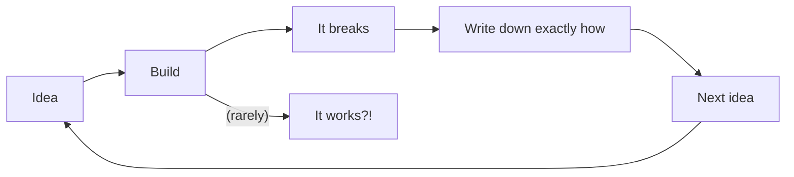

**AI Engineer · Software Architect · Open-source builder**

[LinkedIn](https://www.linkedin.com/in/antonio-antenore-a9b44a107/) · Turin, Italy

> **Looking for rope partners.** I am open to collaborations, idea swaps and brainstorming on interesting projects. Write to me on [LinkedIn](https://www.linkedin.com/in/antonio-antenore-a9b44a107/) or open a discussion or issue on any of my repositories.

AI engineer and software architect in Turin, Italy, building open-source agentic AI systems: multi-agent orchestration, MCP and A2A, local LLM runtimes, knowledge graphs and forecasting.

| Accepting | Politely declining |
| --- | --- |
| Interesting problems | "Synergies" |
| Half-baked ideas | Meetings that could have been an issue |
| Brainstorming | Rewriting it in whatever is trending this week |
| Strong opinions about local vs cloud models | Quick calls to discuss what a README already says |

I help product and engineering teams turn useful AI ideas into dependable products: private when they need to be, efficient enough to run in the real world, and clear enough for people to understand and trust. Yes, that is a lot of adjectives. I stand by each one.

| Currently | What |
| --- | --- |
| Building | Agents that do not need babysitting |
| Learning | Local and distributed inference |
| Climbing | Whatever the weather allows |

## Pitch 1 · How this place works: building open-source AI prototypes

When an idea crosses my mind, I build it, mostly to find out where it breaks. Every repository here is a small lab: an idea, an implementation, and a pile of problems I only discovered by trying. Safety goggles not included.

Not everything works. Each project's README says what is proven and what is still open. Think of them as maps of the traps, drawn by someone who stepped on most of them first.

## Pitch 2 · Where to look: open-source AI agent projects

The pinned repositories are what I would show first. Everything else is in the [repositories tab](https://github.com/aantenore?tab=repositories), most recently updated first. Archaeology is encouraged, judgement is not.

Four projects, each with a live release badge. Think of it as the latest sends: proof that the rope held.

| Project | What it does | Latest sends |
| --- | --- | --- |
| [reinloop](https://github.com/aantenore/reinloop) | Agents as files, harness included. Zero-dependency agent runtime: budgets, permissions, durable resume, multi-agent patterns, MCP, OpenTelemetry. |  |
| [lorebase](https://github.com/aantenore/lorebase) | Open-source ontology and knowledge platform for AI agents: model, version, merge and explore enterprise knowledge, expose it via API and MCP. |  |
| [agent-layers](https://github.com/aantenore/agent-layers) | Technology-neutral SDK that composes the eleven layers of an agent, from prototype to production, through swappable adapters. |  |
| [agent-plexus](https://github.com/aantenore/agent-plexus) | Composes agents into multi-agent systems: members, registry, routing, topology, execution and fault attribution. Zero-dependency core; any framework joins over A2A. |  |

## Pitch 3 · Engineering principles for agentic AI and software architecture

Things I believe, with receipts

 

**Configuration over hardcoding.** Models, providers, policies, and infrastructure should be replaceable without redesigning the product. Because "works on my machine" is not a deployment strategy.

**Explicit contracts.** Clear boundaries and verifiable outcomes make complex systems safer to change. Vibes are not an interface.

**Local-first where it matters.** Privacy, cost control, reproducibility, and offline use are product capabilities. The cloud is just someone else's computer, with an invoice.

**Evidence before claims.** Tests, evaluations, and operational records should support every important guarantee. "Trust me" is not a test case.

**Useful to people.** Technical novelty matters only when its real-world benefit can be explained plainly. If it needs a keynote to justify it, it probably needs a rethink.

## Pitch 4 · Off the keyboard: the wall

Climbing taught me one thing twice: nobody summits alone. You study the route, you build your skills on small walls, you meet the people who know the terrain, and you reach the goal roped to a team. Sofie supervises from the ground with zero technical opinions and a firm interest in treats.

| Climbing | Engineering translation |
| --- | --- |
| Study the route | Read the docs and the code before pulling |
| Small projects | Every repo here is a practice wall |
| Meet people | Issues, discussions and strangers who know better |
| Share the beta | Every README documents the traps |
| Rope up | Collaborations welcome |

Beta, for non-climbers, is route information passed on by whoever climbed it first.

## Pitch 5 · Broader experience: microservices, cloud-native, data platforms

My background spans full-stack development, microservices, distributed systems, data engineering, cloud-native architecture, and applied AI, with a research background in security and privacy for IoT systems. Away from the keyboard, there is the wall and a dog named Sofie, who has no opinions on architecture.

Current interests: Agentic AI · Multi-agent systems · MCP and A2A · Local AI · Distributed Inference · Forecasting · Knowledge graphs · Data Platforms · Event-driven architecture · Cloud Native · AWS · Kafka · Python · TypeScript · Java / Spring Boot · React

## Summit · Connect

The best place to reach me and follow my professional work is [LinkedIn](https://www.linkedin.com/in/antonio-antenore-a9b44a107/). You can also open a discussion or issue on any repository.

Well-formed bug reports get answered faster than buzzwords. Mostly.
