&nbsp;&nbsp;

<a href="#climb">Climb</a> · <a href="#rules">Rules</a> · <a href="#rack">Rack</a> · <a href="#wall">Wall</a> · <a href="#rope">Rope</a> · <a href="#summit">Summit</a>

<h3 align="center">AI engineer building open-source agentic AI, one pitch at a time</h3>

I help teams turn useful AI ideas into dependable products. Best bits are pinned; the rest is in the <a href="https://github.com/aantenore?tab=repositories">repositories tab</a>.

<h3 align="center">Engineering principles for AI systems</h3>

The principles, as text

 

**Configuration over hardcoding.** Models, providers, policies, and infrastructure should be replaceable without redesigning the product. Because "works on my machine" is not a deployment strategy.

**Explicit contracts.** Clear boundaries and verifiable outcomes make complex systems safer to change. Vibes are not an interface.

**Local-first where it matters.** Privacy, cost control, reproducibility, and offline use are product capabilities. The cloud is just someone else's computer, with an invoice.

**Evidence before claims.** Tests, evaluations, and operational records should support every important guarantee. "Trust me" is not a test case.

**Useful to people.** Technical novelty matters only when its real-world benefit can be explained plainly. If it needs a keynote to justify it, it probably needs a rethink.

<h3 align="center">The rack: agentic AI, MCP and A2A, local LLMs and the stack behind them</h3>

The rack, as text

 

Interests: agentic AI, multi-agent systems, MCP and A2A, local AI, distributed inference, forecasting, knowledge graphs, data platforms, event-driven architecture, cloud native, AWS, Kafka, Python, TypeScript, Java / Spring Boot, React.

Background: full-stack, microservices, distributed systems, data engineering, cloud-native and applied AI, with research in security and privacy for IoT systems.

<h3 align="center">Off the keyboard: climbing, skiing and Sofie</h3>

Climbing (the obsession), skiing (a work in progress) and the mountain in general, with Sofie, a dog with no opinions on architecture.

<h3 align="center">Collaborations and rope partners</h3>

Open to collaborations, idea swaps and brainstorming on interesting projects. 
AI engineer and software architect in Turin, Italy, building open-source agentic AI systems: multi-agent orchestration, MCP and A2A, local LLM runtimes, knowledge graphs and forecasting.

<h3 align="center">Summit: let's connect</h3>

&nbsp;&nbsp;

Well-formed bug reports get answered faster than buzzwords. Mostly.

