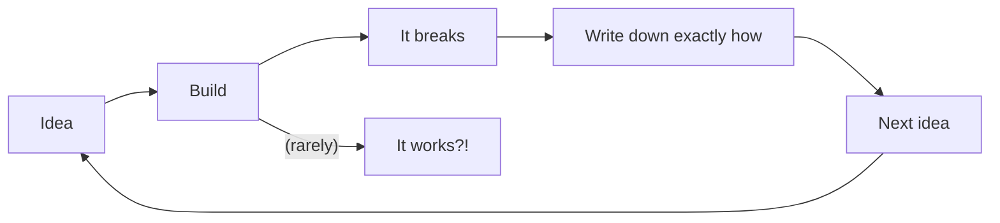

**AI Engineer · Software Architect · Open-source builder**

[LinkedIn](https://www.linkedin.com/in/antonio-antenore-a9b44a107/) · Turin, Italy

> **Open to collaborations.** I am open to collaborations, idea swaps and brainstorming on interesting projects. Write to me on [LinkedIn](https://www.linkedin.com/in/antonio-antenore-a9b44a107/) or open a discussion or issue on any of my repositories.

| Accepting | Politely declining |
| --- | --- |
| Interesting problems | "Synergies" |
| Half-baked ideas | Meetings that could have been an issue |
| Brainstorming | Rewriting it in whatever is trending this week |
| Strong opinions about local vs cloud models | Quick calls to discuss what a README already says |

I help product and engineering teams turn useful AI ideas into dependable products: private when they need to be, efficient enough to run in the real world, and clear enough for people to understand and trust. Yes, that is a lot of adjectives. I stand by each one.

## How this place works

When an idea crosses my mind, I build it, mostly to find out where it breaks. Every repository here is a small lab: an idea, an implementation, and a pile of problems I only discovered by trying. Safety goggles not included.

Not everything works. Each project's README says what is proven and what is still open. Think of them as maps of the traps, drawn by someone who stepped on most of them first.

## Where to look

The pinned repositories are what I would show first. Everything else is in the [repositories tab](https://github.com/aantenore?tab=repositories), most recently updated first. Archaeology is encouraged, judgement is not.

## Engineering principles

Things I believe, with receipts

 

**Configuration over hardcoding.** Models, providers, policies, and infrastructure should be replaceable without redesigning the product. Because "works on my machine" is not a deployment strategy.

**Explicit contracts.** Clear boundaries and verifiable outcomes make complex systems safer to change. Vibes are not an interface.

**Local-first where it matters.** Privacy, cost control, reproducibility, and offline use are product capabilities. The cloud is just someone else's computer, with an invoice.

**Evidence before claims.** Tests, evaluations, and operational records should support every important guarantee. "Trust me" is not a test case.

**Useful to people.** Technical novelty matters only when its real-world benefit can be explained plainly. If it needs a keynote to justify it, it probably needs a rethink.

## Broader experience

My background spans full-stack development, microservices, distributed systems, data engineering, cloud-native architecture, and applied AI, with a research background in security and privacy for IoT systems. Away from the keyboard, I climb (and there is a dog named Sofie, who has no opinions on architecture).

Current interests: Agentic AI · Local AI · Distributed Inference · MCP · Forecasting · Data Platforms · Cloud Native · Python · TypeScript · Java / Spring · React

## Connect

The best place to reach me and follow my professional work is [LinkedIn](https://www.linkedin.com/in/antonio-antenore-a9b44a107/). You can also open a discussion or issue on any repository.

Well-formed bug reports get answered faster than buzzwords. Mostly.
